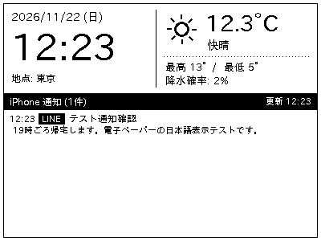
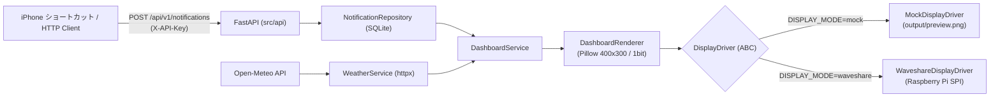

# epaper-dashboard

Raspberry Pi Zero 2 W + Waveshare 4.2inch e-Paper Module（400×300 / 白黒 1bit / SPI）向けのローカル電子ペーパーダッシュボードです（Phase 1: Docker + モックドライバによるローカル開発プロトタイプ）。

> 関連リポジトリ: [ai-travel-planner（ポートフォリオ & SDD）](https://github.com/Ono-L/ai-travel-planner) / [gbf-beginner-bot](https://github.com/Ono-L/gbf-beginner-bot) / [GitHub プロフィール (@Ono-L)](https://github.com/Ono-L)

---

## 実出力プレビュー（400×300px / 1bit モノクロ PNG）

Pillow 描画エンジンにより生成された実際の電子ペーパー向け 1bit モノクロ出力画像です。



---

## 主な機能

- **天気取得（Open-Meteo API）**: API キー不要で現在天気・気温・最高／最低気温・降水確率を取得（ネットワーク障害時はフォールバック値を返しアプリ停止を防止）
- **通知受信 Webhook API**: iPhone ショートカット等から `POST /api/v1/notifications` で通知を受信し、SQLite に永続化（`X-API-Key` 認証必須）
- **電子ペーパー描画エンジン**: 400×300 ピクセルの 1bit モノクロ PNG（Pillow モード `"1"`）を日本語フォント（IPAex ゴシック）で折り返し生成
- **ドライバ抽象化**: ローカル開発用モック（`DISPLAY_MODE=mock` → `output/preview.png`）と実機ドライバ（`DISPLAY_MODE=waveshare`）を抽象基底クラス＋Factory パターンで完全分離
- **ブラウザプレビュー UI**: `http://localhost:8000/preview` で 400×300 画像の確認とテスト通知の送信が可能

---

## アーキテクチャ & 設計のポイント



### 設計・セキュリティ・品質のこだわり

1. **実機レス開発を前提としたドライバ抽象化**
   - `DisplayDriver` 抽象基底クラス（[src/display/base.py](./src/display/base.py)）で解像度・1bit 色空間の事前検証を共通化し、ハードウェア調達前でも Docker 上で描画・通知 API の開発サイクルを高速反復できます。実機移行時は `DISPLAY_MODE=waveshare` への切替のみで描画ロジックの変更は不要です。
2. **厳格な型設計とバリデーション**
   - Python 3.12 の型ヒントを全モジュールに明記し、Pydantic v2（`BaseModel` / `BaseSettings`）で API 入出力と環境設定を厳密検証。
3. **認証・タイミング攻撃対策とフェイルクローズ**
   - `X-API-Key` 検証に `hmac.compare_digest` を使用し、サーバー側 `API_KEY` 未設定・空文字時は必ず HTTP 401 で拒否（[src/api/dependencies.py](./src/api/dependencies.py)）。
   - SQLite 操作はパラメータバインドを徹底。
4. **自動テスト（pytest / 3 テストスイート）**
   - `tests/test_notifications_api.py`: 認証未指定／不正キー／サーバーキー未設定の 401 拒否、CRUD ライフサイクル、`/preview` 検証
   - `tests/test_display_renderer.py`: 400×300 / 1bit モノクロ生成・描画ピクセル検証・0 件時挙動・不正サイズ拒否・実機スタブ例外検証
   - `tests/test_weather_service.py`: Open-Meteo 応答パース・WMO コード変換・ネットワーク障害フォールバック検証（`httpx.MockTransport`）

---

## 技術スタック

| カテゴリ | 採用技術 |
| :--- | :--- |
| **言語・Web フレームワーク** | Python 3.12 / FastAPI / Uvicorn / Pydantic v2 |
| **画像描画・通信・永続化** | Pillow（1bit モノクロ PNG / IPAex ゴシック）/ httpx / SQLite |
| **実行環境・テスト** | Docker / Docker Compose / pytest / pytest-asyncio |

---

## クイックスタート（Docker）

```bash
# 1. 環境変数ファイルを準備（任意：未作成時はデフォルト開発キーで起動）
cp .env.example .env

# 2. コンテナのビルドと起動
docker compose up -d --build

# 3. 自動テストの実行
docker compose exec app pytest -v
```

起動後、ブラウザで `http://localhost:8000/preview` を開いてプレビューとテスト通知を確認できます。

## API 利用例

```bash
# 通知送信（X-API-Key 必須）
curl -X POST http://localhost:8000/api/v1/notifications \
  -H "Content-Type: application/json" \
  -H "X-API-Key: change-me-local-dev-key" \
  -d '{"app_name": "LINE", "title": "買い物メモ", "body": "帰りに牛乳とパンを買う"}'

# 通知一覧取得
curl http://localhost:8000/api/v1/notifications \
  -H "X-API-Key: change-me-local-dev-key"

# 通知クリア
curl -X DELETE http://localhost:8000/api/v1/notifications \
  -H "X-API-Key: change-me-local-dev-key"
```
